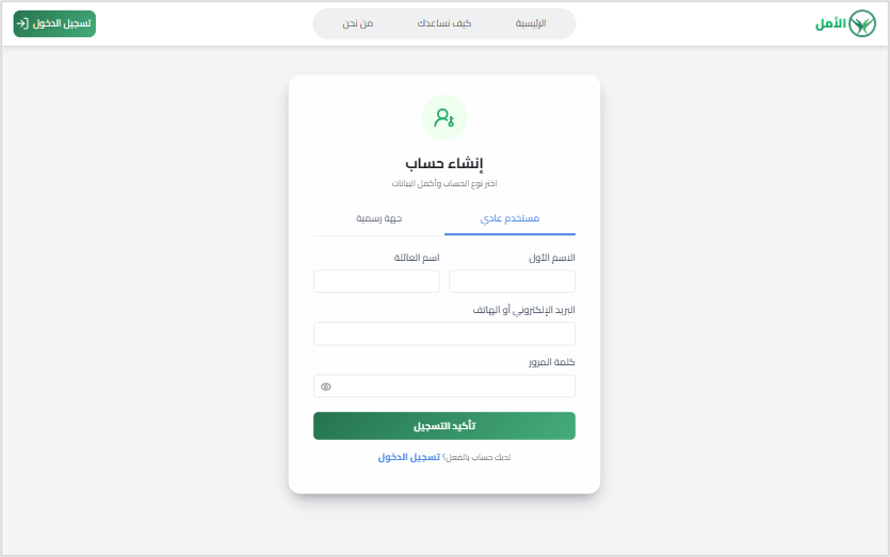
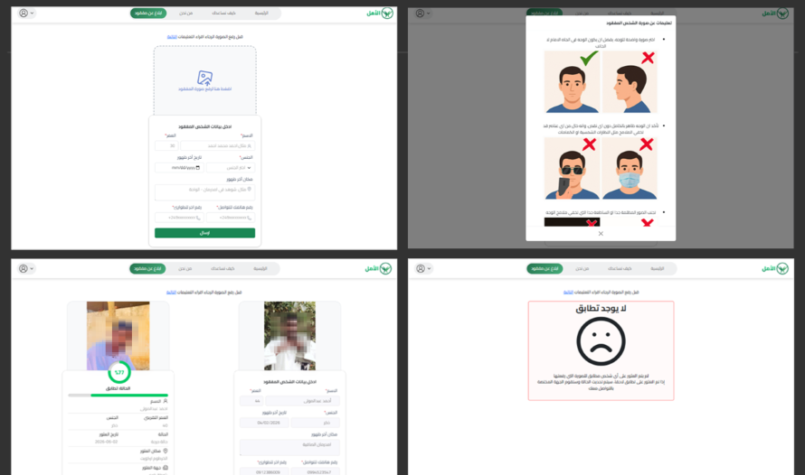
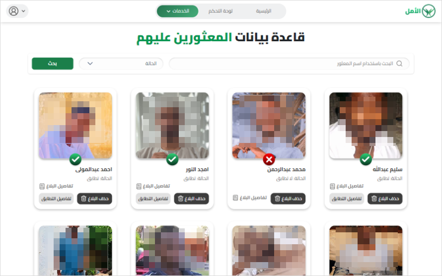
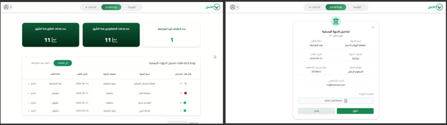

# Missing Person Identification Website

**A face-recognition web platform for reporting missing people and matching them with found-person reports.**

[](https://react.dev/)
[](https://vite.dev/)
[](https://flask.palletsprojects.com/)
[](https://www.mysql.com/)

## Overview

The platform helps normal users, authorities, and administrators submit and manage missing/found-person reports. It uses facial embeddings and FAISS similarity search to find strong or uncertain matches, then allows authorized users to validate them.

## User Roles

| Role            | What they can do                                                                                                |
| --------------- | --------------------------------------------------------------------------------------------------------------- |
| **Normal user** | Submit missing-person reports, manage owned reports and matches, and update their profile.                      |
| **Authority**   | Register for approval, submit found-person reports, manage owned reports, and view the missing-person database. |
| **Admin**       | Manage authority applications, both person databases, matches, and dashboard statistics.                        |

Authority accounts remain `pending` until an admin changes the status to `approved`; rejected accounts cannot log in.

## Features

### Normal users

- Sign up and log in with email or phone.
- Submit missing-person reports with an image and case details.
- Edit or delete owned reports and validate uncertain matches.
- Update profile information and password.

### Authorities

- Submit authority registration with supporting documentation.
- Submit and manage found-person reports.
- Browse missing-person records and match details.
- Confirm, reject, or cancel owned matches.

### Admins

- Review authority applications and send approval/rejection notifications.
- View authority, missing-report, and found-report statistics.
- Browse, inspect, and delete records in both databases.
- Manage match results.

## Tech Stack

**Frontend:** JavaScript, JSX, React, React Router, Vite, Axios, Bootstrap, Lucide React  
**Backend:** Python, Flask, Flask-JWT-Extended, Flask-CORS, Flask-Mail, MySQLdb/MySQL  
**Face recognition:** InsightFace, ArcFace, ONNX Runtime, OpenCV, NumPy, Pillow, FAISS

## Architecture

The React frontend calls the Flask REST API through Axios and cookie-based JWT authentication. The API stores case data in MySQL and face embeddings in local FAISS indexes.

```text
frontend/  # React UI, role routes, components, and API services
backend/   # Flask API, MySQL access, and facial-recognition services
docs/      # Detailed API and setup documentation
```

Core database tables: `users`, `authority`, `missing_persons`, `found_persons`, and `match_results`.

## Quick Start

```bash
git clone <repository-url>
cd Missing-Person-Identification-website

cd backend
python3.12 -m venv venv
source venv/bin/activate
pip install -r requirements.txt

# From the repository root: cp .env.example .env, then fill in the placeholders.
python run.py
```

In a second terminal:

```bash
cd frontend
npm install
npm run dev
```

Set `VITE_API_URL=http://127.0.0.1:5000` in `frontend/.env`. Open `http://localhost:5173`; the backend runs at `http://127.0.0.1:5000`.

### Database Setup

Copy `.env.example` to `.env`, fill in the placeholders, then create the schema and placeholder accounts:

```bash
cp .env.example .env
cd backend
mysql -h 127.0.0.1 -P 3306 -u <mysql-user> -p < db/schema.sql
python db/seed.py
```

See [Setup Guide](docs/SETUP.md) for MySQL setup, environment variables, account creation, build commands, and troubleshooting.

## API Overview

| Base route                                         | Purpose                                                |
| -------------------------------------------------- | ------------------------------------------------------ |
| `/api/auth/*`                                      | Signup, login, current-user lookup, and logout         |
| `/api/admin/*`                                     | Authority management and dashboard statistics          |
| `/api/missing-report/*`, `/api/report/*`           | Create missing-person reports and validate matches     |
| `/api/my-missing-cases*`, `/api/my-missing-match*` | Manage a normal user's missing reports and matches     |
| `/api/found-report/*`, `/api/found-match/*`        | Create found-person reports and validate owned matches |
| `/api/my-found-cases*`                             | Manage an authority/admin user's found reports         |
| `/api/missing-database*`                           | Browse or manage missing-person database records       |
| `/api/found-database*`                             | Browse or manage found-person database records         |
| `/api/user-profile*`                               | Get and update a normal user's profile                 |

See [API Reference](docs/API.md) for every route, method, role, and description.

## Screenshots

The following are selected screenshots showcasing some of the application's interfaces and features. They represent only a portion of the available functionality

### Home Page


### SignUp Page



### Missing Person Reporting Page (Normal User)



### Found Persons Reports Management Page (Admin & Authorities)



### Admin Dahsboard



---
